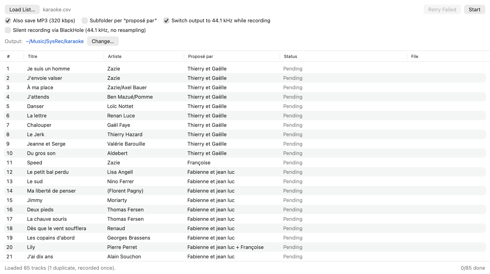
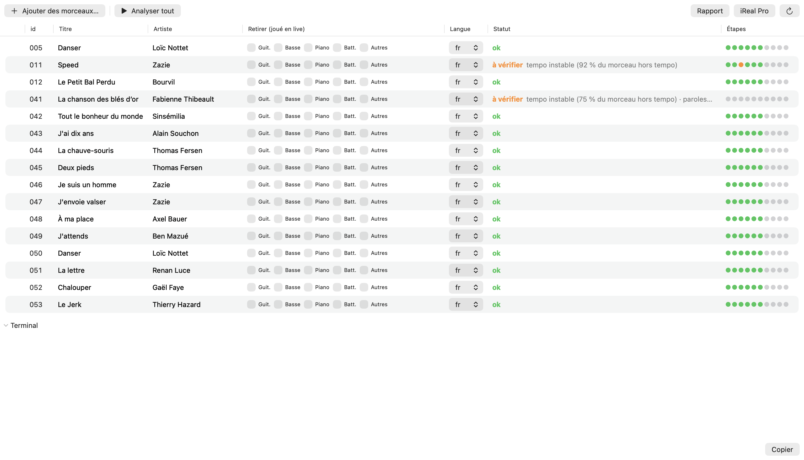
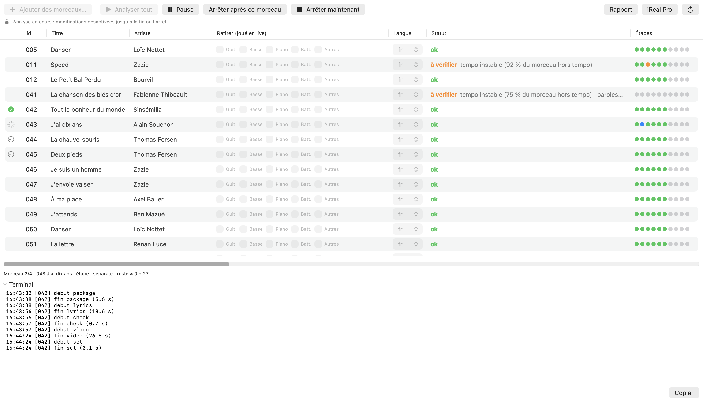
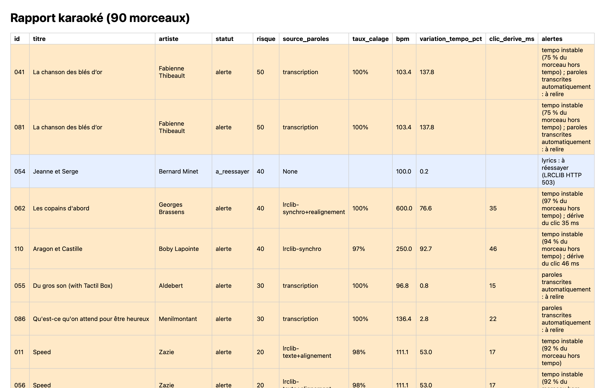
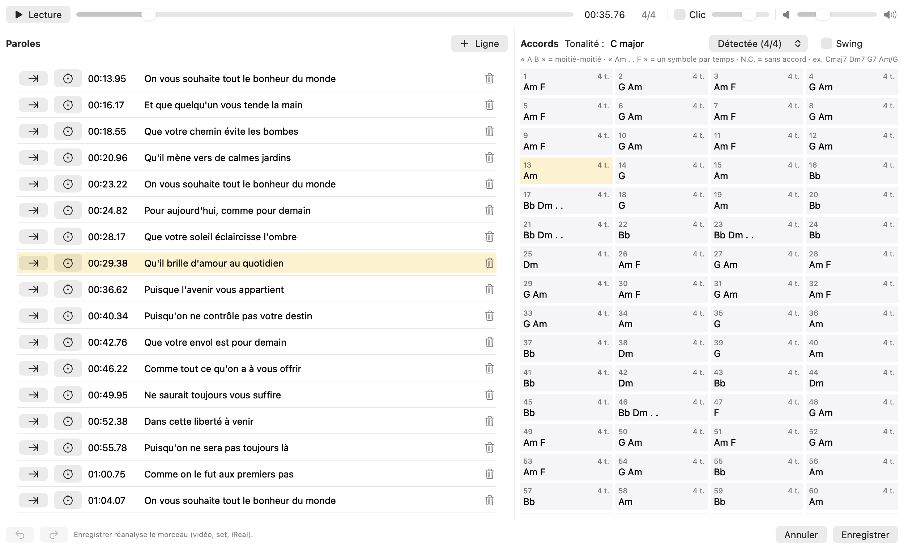
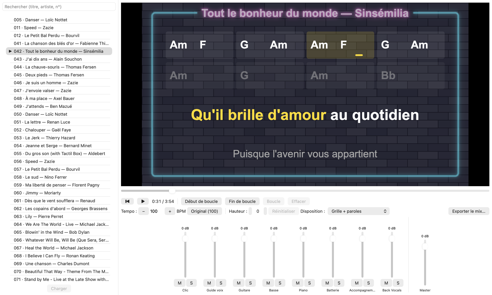
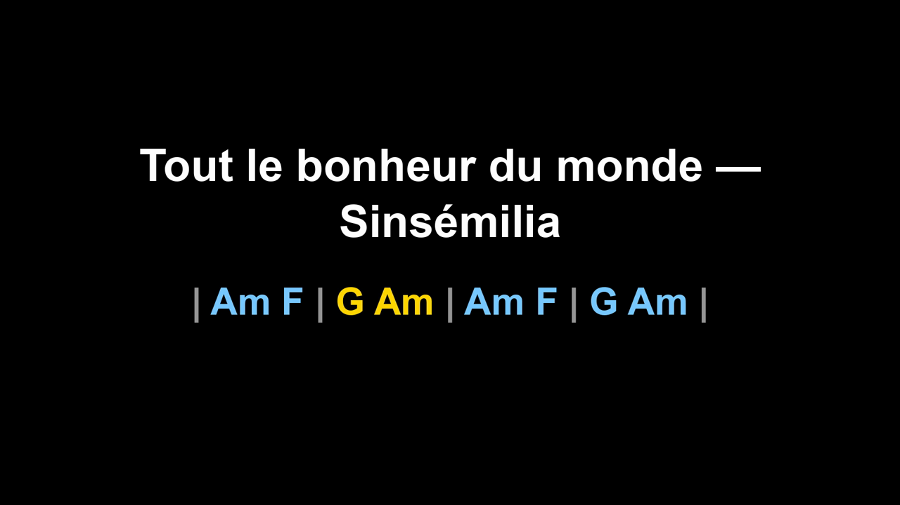
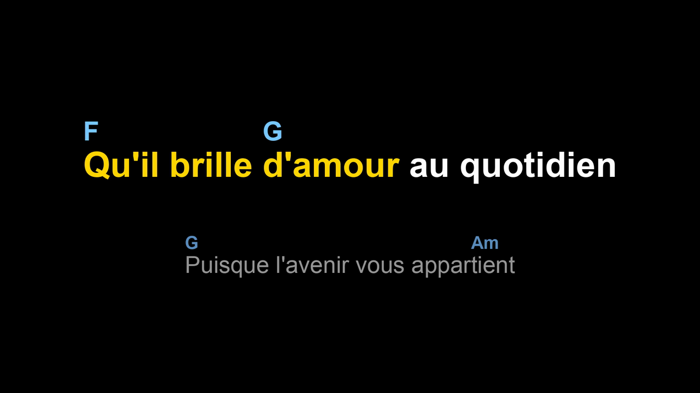
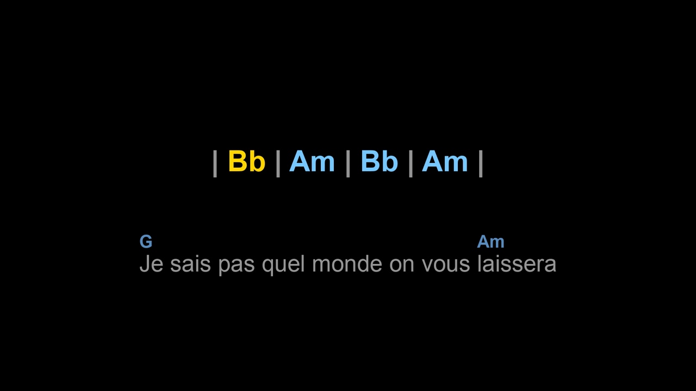
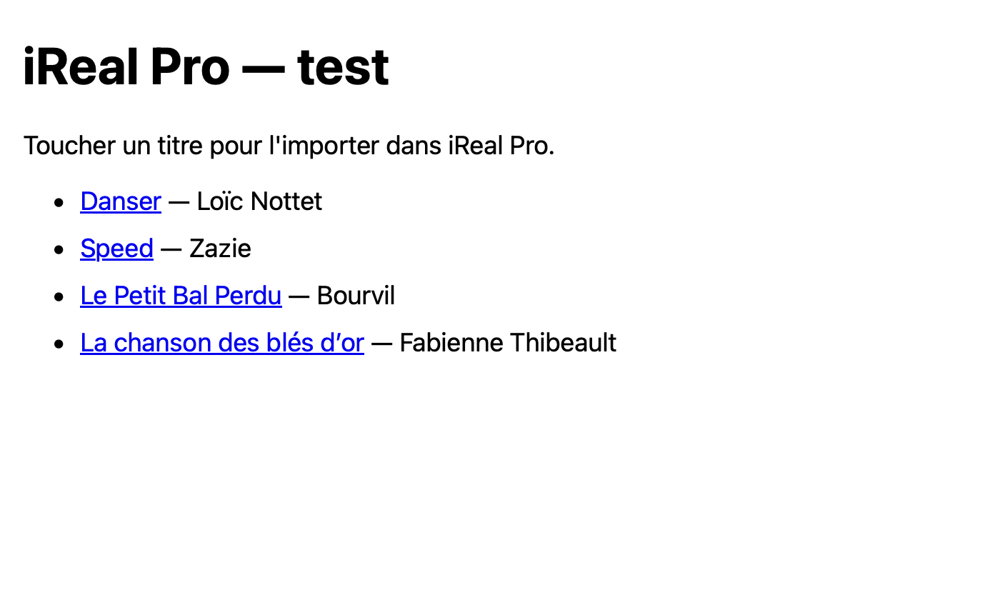

# Karaifyer : guide d'utilisation

Karaifyer prépare un spectacle karaoké live. Il enregistre des chansons depuis Spotify, puis les analyse.
Chaque morceau ressort avec :
- les pistes séparées pour la XR18, avec un clic ;
- une vidéo des paroles avec les accords ;
- une grille d'accords et un lien iReal Pro ;
- un set Ableton prêt à jouer.

Tout se fait dans une seule fenêtre, avec deux onglets : **Enregistrement** et **Karaoké**.

---

## 1. Installation et premier lancement

Sur un Mac neuf (macOS 26 ou plus récent), dans le Terminal :

```sh
xcode-select --install                    # outils de développement d'Apple (pas besoin de Xcode)
brew install uv ffmpeg git                # installer Homebrew d'abord si besoin : https://brew.sh
git clone https://github.com/akkaouim/Karaifyer.git    # n'importe où
cd Karaifyer/karaifyer && ./build-app.sh --install     # → ~/Applications/Karaifyer.app
```

**Au premier lancement**, Karaifyer propose de **créer le dossier karaoké**. Par défaut c'est `~/Karaoke`, ou
« Choisir un autre emplacement… », par exemple sur un disque externe. Il y crée tout ce qu'il faut :
- les dossiers de travail ;
- un manifeste vide ;
- un gabarit Ableton par défaut, à adapter à ton routage si ta table n'est pas une XR18 câblée de la même façon.

Les outils d'analyse et leurs modèles se téléchargent seuls à la première analyse (plusieurs Go : prévoir du
temps et de la place).

**Premier lancement :** macOS demande deux autorisations, à accepter :
- **enregistrer l'audio du système**, pour capter Spotify ;
- **contrôler Spotify**, pour lancer chaque titre et savoir quand il se termine.

**Où trouver l'app :** Karaifyer a son icône dans le Dock et dans ⌘-Tab. Une petite icône dans la barre des
menus donne l'état de l'enregistrement et de l'analyse en un coup d'œil.

**Réglages (⌘,) :** ils indiquent où se trouvent le dossier karaoké, le gabarit Ableton et le code du pipeline
(le dépôt cloné, trouvé automatiquement). « Tout est prêt » en vert signifie que rien ne manque. Sinon, un bandeau orange
dans l'onglet Karaoké dit quoi faire, par exemple « disque débranché ».


---

## 2. Le parcours en bref

1. **Enregistrer** les chansons depuis Spotify (onglet Enregistrement).
2. **Ajouter** les morceaux à analyser (onglet Karaoké), y compris des fichiers qui ne viennent pas de Spotify.
3. **Régler** chaque morceau : parties jouées en live, langue, Set List.
4. **Analyser**. Cela peut tourner la nuit (environ 9 min par morceau) et reprend là où ça s'est arrêté.
5. **Vérifier** les morceaux « à vérifier », grâce au statut, aux pastilles et au rapport.
6. **Corriger** paroles et accords à l'oreille si besoin.
7. **Jouer** : ouvrir le set Ableton du morceau, le projecteur affiche la vidéo.

---

## 3. Enregistrer depuis Spotify



- **Load List…** charge la feuille exportée en CSV (colonnes titre, artiste, lien Spotify, proposé par).
- **Start** lance l'enregistrement. Chaque ligne est jouée dans Spotify, enregistrée sans perte (FLAC, plus
  un MP3 en option) puis découpée exactement à la fin du titre. L'enregistrement capte uniquement Spotify,
  pas les autres sons du Mac.
- **Reprise :** une ligne déjà enregistrée (son fichier existe) est sautée. Pour réenregistrer un titre,
  supprime ses fichiers et relance **Start**.
- **Réglages Spotify conseillés :** qualité Lossless (ou Très élevée), normalisation du volume désactivée,
  fondu enchaîné à 0 s.

**Si une prise est abîmée** (micro-coupures, capture défectueuse), Karaifyer la refait. Pour une capture
défectueuse, il reconstruit la capture et relance Spotify avant de réessayer. Si le problème persiste, la
ligne est marquée ✗ « capture défectueuse » et aucun fichier abîmé n'est gardé. En fin de série, le journal
`sysrec-log.txt` résume les lignes « À vérifier ».

---

## 4. L'onglet Karaoké



**Barre d'outils**
- **Ajouter des morceaux…** accepte n'importe quels fichiers audio (FLAC, WAV, MP3, M4A, AIFF). Le titre et
  l'artiste sont lus dans les tags, ou à défaut dans le nom du fichier. Un fichier déjà présent est ignoré.
- **Analyser tout / la sélection.**
- **Rapport** ouvre le rapport global ; **iReal Pro** ouvre la page des liens d'import.

**Colonnes**
- **Titre, Artiste :** modifiables. Clique dans la case, tape, puis Entrée.
- **Retirer (joué en live) :** les parties que vous jouez sur scène. Leur fader XR18 démarre à zéro au début
  du morceau ; les autres démarrent à 0 dB. « Autres » correspond à l'accompagnement (canaux 17–18), par
  exemple des claviers joués en live.
- **Langue :** langue des paroles, utilisée pour l'alignement et la transcription.
- **Statut :** l'état du morceau, suivi du détail des problèmes. Survole-le pour l'explication complète.
- **Étapes :** une pastille par étape de l'analyse.

| Pastille | Signification |
|---|---|
| 🟢 verte | étape faite et à jour |
| 🟠 orange | étape faite, mais son résultat est à vérifier (survole pour voir pourquoi) |
| 🔵 bleue | en cours |
| 🔴 rouge | échec (le message apparaît au survol) |
| ⚪ grise | à faire ou à refaire (un réglage ou une étape précédente a changé) |

**Clic droit sur un morceau**
- Ouvrir le dossier, la vidéo, le set Ableton, la grille d'accords ou le journal.
- **Corriger paroles et accords…** (section 7).
- **Changer de Set List…** : la Set List range le set Ableton du morceau dans le bon dossier de la soirée.
- **Refaire le morceau**, ou **Refaire une étape** ▸.

---

## 5. Analyser



- **Un morceau à la fois.** Ce qui est déjà à jour est sauté.
- **Pause / Reprendre :** même après des heures. **Arrêter après ce morceau** termine le morceau en cours
  puis s'arrête. **Arrêter maintenant** interrompt tout de suite ; l'étape interrompue sera refaite à la
  prochaine analyse.
- **Pendant l'analyse, les réglages sont verrouillés** (un cadenas l'indique). Ils redeviennent modifiables à
  la fin ou après un arrêt.
- **Marqueurs (colonne de gauche) :**
  - roue qui tourne : le morceau en cours ;
  - horloge : un morceau en attente ;
  - ✓ ou ✗ : un morceau terminé pendant cette analyse.
- **Barre de progression :** affiche le morceau, l'étape et le temps restant estimé. Le **Terminal** montre le
  journal en direct, chaque ligne précédée de son heure (bouton **Copier**).
- **Nouvel essai automatique :** à la fin d'une analyse, les morceaux restés « à réessayer » (service de
  paroles LRCLIB injoignable) sont relancés une fois.
- **Le Mac ne se met pas en veille** pendant l'analyse. Si tu lances un enregistrement pendant une analyse,
  Karaifyer propose de la mettre en pause ; elle reprend toute seule à la fin de l'enregistrement.

---

## 6. Lire le statut et les alertes

| Alerte | Ce que ça veut dire | Que faire |
|---|---|---|
| **tempo instable (X % du morceau hors tempo)** | le tempo varie vraiment (vieil enregistrement, morceau joué sans clic, changement de tempo) | écouter le clic avant le spectacle, ou le couper sur ce morceau |
| **dérive du clic N ms** | sur un passage, le clic s'écarte de la batterie de plus de 30 ms | écouter ce passage au retour |
| **paroles transcrites automatiquement : à relire** | aucune parole trouvée en ligne : elles ont été transcrites depuis la voix | relire et corriger dans l'éditeur |
| **paroles à vérifier : X % des mots calés** | l'alignement des mots sur la voix est imparfait | vérifier dans l'éditeur ou la vidéo |
| **sans paroles** | rien trouvé et rien entendu (instrumental) | déposer un texte `paroles/<id>.txt` si besoin |
| **à réessayer** | service en ligne injoignable | relancer plus tard (fait automatiquement une fois) |

Le **rapport** (bouton Rapport) liste tous les morceaux, du plus à risque au moins à risque :



---

## 7. Corriger paroles et accords

**Clic droit sur le morceau, puis Corriger paroles et accords…** La fenêtre s'ouvre par-dessus Karaifyer.



- **Lecture** (⌥ Espace) joue l'enregistrement. La ligne et la mesure en cours sont surlignées en jaune.
- **Volume :** le curseur à droite de la barre de lecture règle le volume (mémorisé pour tous les morceaux).
- **Paroles (à gauche) :** cliquer une ligne y va. Le temps et le texte sont modifiables. ⏱ cale le début de
  la ligne sur la lecture ; + ajoute une ligne, la corbeille la supprime.
- **Accords (à droite) :** une case par mesure, 4 par ligne ; cliquer le numéro va à la mesure. La tonalité
  est modifiable en haut (ex. « C# minor »).
  - `A B` : les deux accords se partagent la mesure ;
  - `Am . . F` : un symbole par temps, `.` prolonge l'accord précédent ;
  - `N.C.` : pas d'accord ;
  - accords reconnus : `C`, `C#m`, `Bb7`, `Cmaj7`, `Dm7`, `F#m7b5`, `Gsus4`, `Edim`, `Caug`, `A6`, `D9`,
    `Cadd9`, avec une basse : `C/E`, `Am/G`. Une case invalide est entourée de rouge.
- **Enregistrer** réanalyse le morceau : vidéo, set Ableton et page iReal sont refaits. Seul ce que tu as
  modifié devient une correction (paroles et/ou accords).
- **Les corrections ne sont jamais écrasées** par une nouvelle analyse. Pour revenir à la détection
  automatique, supprime le fichier `paroles/<id>.lrc` ou `accords/<id>.txt` dans le dossier karaoké, puis
  refais le morceau.

**Paroles introuvables en ligne :** Karaifyer les transcrit depuis la voix du chanteur (alerte « à relire »).
Tu peux aussi déposer un texte brut `paroles/<id>.txt` ; il sera calé automatiquement sur la voix.

---

## 7 bis. Le Lecteur : répéter et vérifier

L'onglet **Lecteur** joue un morceau analysé avec sa vidéo. C'est le Mac qui joue, sur sa sortie audio
habituelle, pas la XR18. Il sert à répéter chez soi en coupant sa partie, et à vérifier la séparation en
écoutant chaque piste seule.



- **Ouvrir un morceau :**
  - cherche par titre, artiste ou numéro (sans te soucier des accents) ;
  - un clic **sélectionne seulement** ; **double-clic**, **Entrée** ou **Charger** ouvre le morceau ;
  - le morceau ouvert est marqué ▶︎, et un morceau grisé n'est pas encore prêt (le survol dit ce qui manque).
- **Vidéo :** double-clic pour le **plein écran**, puis double-clic ou Échap pour en sortir.
- **Transport :** ⏮ retour au début, ▶︎/⏸, et la **barre de position** à faire glisser pour aller n'importe où.
  **Espace** lance ou arrête la lecture, sauf pendant que tu tapes dans la recherche.
- **Boucle :**
  - « Début de boucle » et « Fin de boucle » posent la boucle à l'endroit écouté, **calée sur la barre de
    mesure la plus proche** ;
  - « Boucle » l'active, « Effacer » la supprime, et la zone de la boucle apparaît en jaune sur la barre de
    position.
- **Tempo (BPM) :**
  - le tempo du morceau s'affiche (par exemple 100) ; − / + ou une valeur tapée le change, « Original »
    revient au tempo d'origine ;
  - la hauteur ne change pas, la vidéo et le clic suivent ;
  - la plage va de la moitié à 1,5 fois le tempo d'origine.
- **Hauteur :**
  - de −6 à +6 demi-tons, sans changer le tempo ;
  - « Réinitialiser » revient à la tonalité d'origine ;
  - la vidéo garde les accords d'origine, ce qu'un rappel signale.
- **Mixeur :**
  - une tranche par piste (Clic, Guide voix, Guitare, Basse, Piano, Batterie, Accompagnement, Back Vocals),
    chacune avec un fader (de −∞ à +6 dB), **M** (couper) et **S** (solo) ;
  - avec un solo actif, seules les pistes en solo sont jouées, et une piste coupée reste coupée même en solo ;
  - le **Master** règle le volume général.
- **Mémorisé par morceau :** le mix, le tempo, la hauteur et la boucle (qui se rouvre désactivée). La première
  fois, le morceau s'ouvre comme au spectacle : les parties « Retirer » à zéro, le reste à 0 dB.
- **Exporter le mix… :** tout le morceau, **tel que tu l'entends** (mix, tempo, hauteur ; la boucle est
  ignorée), avec deux choix :

  | Contenu | Formats et qualité |
  |---|---|
  | **Master seul** | AAC (.m4a) ou MP3 en 128, 192, 256 ou 320 kbps ; WAV ou FLAC en 16 ou 24 bits |
  | **Vidéo + master** | MP4 en 1080p ou 720p, qualité Haute ou Standard, son AAC de 128 à 320 kbps |

  Les derniers choix sont gardés. Une barre suit la progression ; « Annuler » ne laisse aucun fichier.

---

## 8. Ce que produit l'analyse

Pour chaque morceau, un dossier `sortie/<id>_<artiste>_<titre>/` contient :
- `accompagnement.flac`, `guitare.flac`, `basse.flac`, `piano.flac`, `batterie.flac`, `back_vocals.flac`,
  `guide_voix.flac` (voix principale, pour les retours) et `clic.flac` (avec décompte) ;
- `paroles.mp4` (vidéo des paroles), `paroles.lrc` et `accords.txt` (grille, 4 mesures par ligne).

### La vidéo des paroles

- **Introduction :** le titre et les premières mesures, la mesure en cours en jaune.

  

- **Pendant le chant :**
  - les syllabes s'allument en jaune au moment où elles sont chantées ;
  - les accords s'affichent au-dessus de la syllabe où ils changent ;
  - la ligne apparaît 0,5 s avant d'être chantée ;
  - la ligne suivante est annoncée en gris, avec ses accords.

  

- **Passages instrumentaux :** à partir d'une mesure sans chant, la grille de 4 mesures s'affiche, avec la
  mesure en cours en jaune. Avant une longue reprise, un décompte 4-3-2-1 suit les derniers temps.

  

### iReal Pro

La page `ireal/<Set List>.html` contient un lien par morceau. Ouvre-la sur l'appareil où iReal Pro est
installé et touche un titre pour l'importer, tonalité incluse. Le tempo se règle dans iReal.



### Le set Ableton

**Un set par morceau,** dans `sets/<Set List>/`, construit à partir de ton gabarit. Il s'ouvre sur la
mesure 1 :

| Mesure | Contenu |
|---|---|
| **1** (silencieuse) | envoi des faders à la XR18 (parties jouées en live à zéro, le reste à 0 dB) |
| **2** | début du morceau : le clic et son décompte, puis tout le reste ; le **repère** du morceau est ici |
| fin | **arrêt automatique** de Live |

- **Play** à l'ouverture envoie les faders, puis le clic démarre.
- **Revenir au repère** (mesure 2) relance le clic depuis le début, sans renvoyer les faders.

**Pistes et canaux de la XR18 :**

| Canal XR18 | Piste |
|---|---|
| 10 | Clic (retours seulement) |
| 11 | Voix guide = chant principal (retours seulement) |
| 12, 13, 14, 15 | Guitare, Basse, Piano, Batterie |
| 16 | Back Vocals |
| 17–18 | Accompagnement (stéréo) |

**Réglages à faire une seule fois** pour les faders et l'arrêt automatique : voir `karaoke/README.md`, section
« Sets Ableton ».

---

## 9. Dépannage

- **Bandeau orange « Pas encore de dossier karaoké » :** clique **Créer le dossier karaoké ici** ou choisis un
  emplacement. Si ton dossier est sur un disque externe, branche-le puis clique **Réessayer**.
- **« uv introuvable » ou « ffmpeg introuvable » :** `brew install uv ffmpeg`, puis **Réessayer**.
- **« à réessayer » sur un morceau :** le service de paroles LRCLIB est temporairement indisponible. Relance
  plus tard (Refaire une étape ▸ lyrics), ou attends le nouvel essai automatique de fin d'analyse.
- **La vidéo d'un morceau ne change pas après une correction :** vérifie que le morceau a bien été réanalysé
  (pastilles vertes), puis rouvre la vidéo.
- **Une ligne d'enregistrement est marquée ✗ « capture défectueuse » :** relance-la (supprime le fichier s'il
  existe, puis **Start**). Si ça se reproduit, envoie le journal `sysrec-log.txt`.
- **Quitter pendant une analyse :** Karaifyer demande confirmation, puis arrête proprement l'analyse.
  L'étape interrompue sera refaite.
